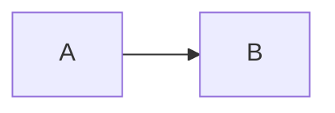

Weekly review
===

> [!tip] Keep it short
> One slide per project.

> [!warning]-
> Folded callout with no title.

> [!info]
> > [!quote] Nested
> > A quote inside.

Things to ==remember== this week. #weekly #review/2026
#inbox #todo

- [ ] Send the deck
- [x] Book the room ^task-1

Revenue grew in every region.[^1]

[^1]: Finance report, October.

$$
\text{growth} = 15\% \quad % a LaTeX comment, kept
$$

| Project | Lead |
| --- | --- |
| [[Apollo launch\|Apollo]] | [[Ana]] |

Results
---

Text under the results heading.

***

After the rule. See #42 for details and C# for the code.
^lonely-id
